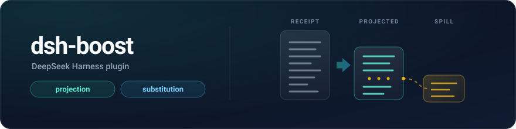
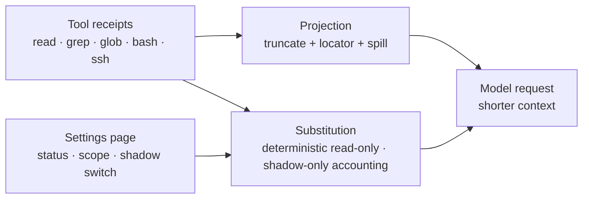

<div align="center">

**English** | [简体中文](README.md)

</div>

<div align="center">



</div>

# dsh-boost

**Cut DeepSeek Harness token usage** — a DSH plugin

**Tool-receipt projection** and **deterministic read-only substitution** shorten the history every
model request replays: large receipts are truncated to head and tail plus a locator, with the
original spilled and re-readable; repeated read-only results across tools are skipped with a
deterministic substitution that saves one model round-trip. A same-origin settings page shows the
degradation codes, the savings ledger and the effective configuration.



> **Status: v1 is implemented.** Projection, substitution and the control surface are all in
> place, and the full test suite passes. The benefit range is an **ex-ante design estimate**
> (3.5% lower bound / 10.0% ideal upper bound; ~0.4% aggregate net on the 300 longest sessions),
> an offline estimate at both ends — **not a per-session floor** — and not reproducible from the
> deliverables. See [`docs/RELEASE.md`](docs/RELEASE.md) §3.

## What it does

DSH replays the whole history on every model request. Across the 300 longest sessions measured
locally, 97.01% of the input was cache reads, and tool receipts dominate the volume (bash 61.75%,
read 22.13%, ssh 10.01%), yet the part of a receipt the next step actually uses is far smaller than
the receipt itself.

The plugin does two things:

- **Projection** — before a tool receipt enters the context, keep its head and tail per tool
  family and replace the middle with a retrievable on-disk handle. The original stays readable;
  the footer names the path. Projection is deterministic and makes no per-call decision.
- **Substitution** — when a repeated read-only call (`read` / `grep` / `glob`) in a plan already
  has deterministic evidence satisfying its guard, commit it without asking the model for another
  decision; with several candidates, one auxiliary request picks one.

The **ex-ante estimate** for v1 is **3.5% (lower bound) to 10.0% (ideal upper bound)** of raw
`totalTokens`; projection's **aggregate net across the 300 longest sessions** is about **0.4%**.
Both ends are offline estimates: **3.5% is not a floor**, and neither figure is a per-session
floor — short sessions can be net negative, and nothing in the deliverable can recompute it. The
corpus, snapshot and derivation live in [how it works](docs/how-it-works.md) (Chinese).

The settings page (the host's **"Token efficiency"** section) shows degradation codes, the savings
ledger and the effective configuration, and edits the scope and the two switches; it writes
`scope.json` through the same CAS as the `boost` tool.

## Install

Node.js `>=24.9.0` and DSH `>=0.2.2-rc.4 <0.2.3-0` (a **range**, not an exact pin). Substitution is
POSIX-only; v1 targets the web profile.

```bash
dsh plugin --profile <name> add dsh-boost@^0.2.6 --registry=https://registry.npmjs.org/
```

`dsh plugin` requires a profile and forwards the remaining arguments to pnpm in that profile
directory (so pnpm must be on `PATH`); for a local checkout, run `npm run build` first and pass the
absolute path to `add`. npmjs has `latest` at `0.2.6`; a mirror may lag, so pass `--registry`
explicitly when the registry matters. Version history, mirrors and the `0.0.0-stage` trap are in
the [operations guide](docs/operating.md#安装与版本) (Chinese). **You must restart DSH after
installing** (plugins load at host startup); for the web profile, restart `dsh web`.

## Enable it

After installation the plugin is inert (with no `scope.json` it is `selected` + an empty list +
shadow). `boost` is a **model tool, not a shell command** — this package has no `bin`, and every
step is a tool call inside the conversation. The shortest honest path:

1. Call `boost` with `{"cmd":"status"}`; confirm `ok: true` and an empty `degraded`.
2. Write the workspace to expose; `baseRevision` is the `revision` you just read (`0` the first
   time):

   ```json
   { "cmd": "scope-set", "body": { "mode": "selected", "workspaceIds": ["<workspace-id>"] }, "baseRevision": 0 }
   ```

3. Shadow for a week: keep `shadow: true` and `projection: "shadow"`, and work normally.
4. Confirm `hasSpill` is `true` **and** `degraded` does not carry `ERR_HOST_SPILL_UNUSABLE`, then
   set `projection` to `"on"`.
5. Once the shadow report is acceptable, set `shadow` to `false`; after the first real
   substitution, watch for the `content[].thinking` 400 as described in
   [`docs/RELEASE.md`](docs/RELEASE.md) §4.

The full walkthrough, every field and rollback are in the [operations guide](docs/operating.md#启用)
(Chinese). `workspaceIds` are the host's workspace UUIDs, not paths; on a single-user machine
without the UUID, `"mode": "global"` is the fallback.

## Settings page

Once installed and enabled in a profile, the host's settings panel gains a **"Token efficiency"**
section (「Token 效率」 in Chinese). It shows state, edits scope, and warns about the two dangerous
switches: turning projection `on` shows the spill precondition, and turning shadow off shows the
`content[].thinking` 400 to watch for. Both give a rollback and both are **advisory, never gates**.
When the page cannot reach its data it shows a stable code instead of an empty table;
`curl <host>/dsh-boost/api/state` returns the same JSON.

| It does | Content |
|---|---|
| Shows | degradation codes and what to do, substitution saving as a lower/upper bound, projection gross/net, retrieval count, receipt counts, fixed overhead, effective configuration (read-only) |
| Writes | four fields of `<dshHome>/boost/scope.json`: `mode`, `workspaceIds`, `shadow`, `projection` |

It writes through the **same** CAS as the `boost` tool's `scope-set`, so neither overwrites the
other; if someone else got there first the page reports `ERR_SCOPE_REVISION_CONFLICT` and keeps
your draft. Per-field and per-code detail is in the
[operations guide](docs/operating.md#降级码与错误码) (Chinese).

## Go deeper

These documents live in the **repository**, not in the npm tarball (`files` ships only `dist`,
`locale`, `static`, `cordis.patch.yml`, both READMEs, `LICENSE`, and `NOTICE`; `src/` is not shipped
either, and the `dist` source maps inline the sources). If you are reading on the npm page, open
them from the repository. The **how-it-works** and **operations** guides are Chinese-only, as
are `docs/RELEASE.md` and the design documents; this English README is the English entry point.

| Document | What it answers |
|---|---|
| [How it works](docs/how-it-works.md) | How projection, substitution and admission work; where the numbers come from; protocol section and cache-prefix stability |
| [Operations](docs/operating.md) | Install, enable, roll back, uninstall; config keys, degradation codes, state fields and known limits |
| [Release acceptance](docs/RELEASE.md) | How to run `npm run verify:package`; the two release-gate invariants, zero peerDependencies and the install spec, the degradation-code matrix; the manual 20-task regression and shadow-week recompute |
| [Design](docs/superpowers/specs/2026-11-18-dsh-token-efficiency-design.md) | Goals, evidence, architecture, contracts, measurement, risks, release shape |
| [Host contracts appendix](docs/superpowers/plans/2026-11-18-host-contracts.md) | Interface reference copied line by line from the host sources |
| [Three-tier delegation research](docs/research/2026-11-18-three-tier-delegation.md) | 25 primary sources on caching, routing thresholds, compression, and verification |

The source and docs live in the repository at
[github.com/SAXEM1997/dsh-boost](https://github.com/SAXEM1997/dsh-boost); `package.json` points
`repository`, `homepage`, and `bugs` at it. The document links above are repository-relative.

## License

Apache-2.0. The mechanisms are ported from [HarnessMM](https://github.com/YuhuaJiang2002/HarnessMM)
(Apache-2.0): the flat candidate bank, GDR guard, CCS single-candidate commit, and the closed-set
selector. **EDG's graph/chain (`predecessor_id`) and the RSI loop were not ported.** A `NOTICE`
ships with the package.
