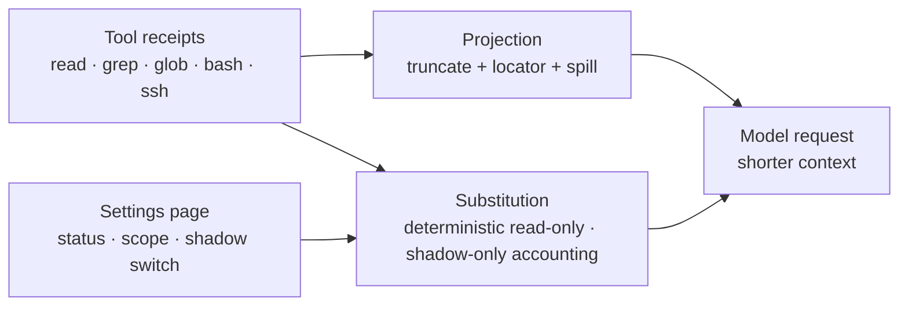

<div align="center">

**English** | [简体中文](README.md)

</div>

# dsh-boost

**Cut DeepSeek Harness token usage** — a DSH plugin

**Tool-receipt projection** and **deterministic read-only substitution** shorten the history every
model request replays: large receipts are truncated to head and tail plus a locator, with the
original spilled and re-readable; repeated read-only results across tools are skipped with a
deterministic substitution that saves one model round-trip. A same-origin settings page shows the
degradation codes, the savings ledger and the effective configuration.



> **Status: v1 is implemented.** Projection, substitution and the control surface are all in
> place, and the full test suite passes. The benefit range is an **ex-ante design estimate**
> (3.5% lower bound / 10.0% ideal upper bound; ~0.4% aggregate net on the 300 longest sessions),
> an offline estimate at both ends — **not a per-session floor** — and not reproducible from the
> deliverables. See [`docs/RELEASE.md`](docs/RELEASE.md) §3.

## What it does

DSH replays the whole history on every model request. Across the 300 longest sessions measured
locally (`npm run --silent stats` — without `--silent`, npm prints its `> dsh-boost@0.2.6 stats`
banner to stdout, so use `--silent` or `node scripts/session-stats.mjs` for machine-readable
output; snapshot at `2026-11-19T03:13:21Z`): 54,141 steps and 54,088 requests,
10,575,904,022 raw tokens in total. The mean is 195,340 tokens per step and 195,531 per request
(median 187,681 per request); 97.01% of the input was cache reads. Tool receipts dominate the
volume (bash 61.75%, read 22.13%, ssh 10.01%), yet the part of a receipt the next step actually
uses is far smaller than the receipt itself.

The plugin does two things:

1. **Projection** — before a tool receipt enters the context, keep its head and tail per tool
   family and replace the middle with a retrievable on-disk handle. The original stays readable;
   the footer names the path. Projection is deterministic and makes no per-call decision.
2. **Substitution** — when a repeated read-only call (`read` / `grep` / `glob`) in a plan already
   has deterministic evidence satisfying its guard, commit it without asking the model for another
   decision. With several candidates, a single-label selector — one auxiliary request
   (`maxTokens` 512 plus its input) — picks one. This is a **narrowing** of original requirement
   2.2: the request asked Jev to score each tool result and decide whether it could feed the next
   tool; v1 only picks one of several candidates on the same receipt, with no per-result scoring.
   That narrowing is the **implementer's scope decision (E2)**, not a user ruling — **no user
   message ratifies it** (see the 2.2 row and implementer decision E2 in the
   [clarification record](docs/superpowers/clarifications/2026-11-18-dsh-token-efficiency.md)).
   For the three substituted tools, the plan's
   `$public` argument binding (copying a value from an earlier receipt into a later call's
   arguments) is effective in practice only for `glob`'s single-token output; `read` and `grep`
   emit line-numbered or bare-path output that the identifier projection cannot match, so those
   calls fall back to the model.

   The multi-candidate selector **does not read a separate model configuration**: it reuses the
   **boundary request's** `provider` / `model` / `reasoningEffort` (`rememberRoute` in
   `src/index.ts`, fed mainly by `agent/pre-step`'s `modelSelection`, with the `agent/request`
   resolution only as a fallback), so it is not necessarily a cheap model. To move it, either
   change the model on the boundary session (the host routes per agent) or leave the plan with a
   single candidate (one candidate never calls the selector).

The **ex-ante estimate** for v1 is **3.5% (lower bound) to 10.0% (ideal upper bound)** of raw
`totalTokens`; **3.5% is not a floor** — it is the lower bound of an offline estimate against a
300-session corpus, and its substitution component (2.70%) is a **ceiling** that must not be
counted as any floor. Projection's **aggregate net across the 300 longest sessions** is about
**0.4%** (gross ~0.8% minus ~0.4% fixed per-request overhead, i.e. 778 / 195,531); that is not a
per-session floor either — long sessions amortise the fixed overhead, **short sessions can be
net negative**, and the `top-300` corpus contains no ≤5-step session. Both 3.5% and 0.4% are
offline estimates, not measurements. It is not a guarantee, and not a figure the shipped
`session-snapshot.json` can recompute: the snapshot stores per-session aggregates plus each
session's `requestTokens` / `receiptChars` arrays, `valueTransfer` / `whitelist` counts, and
its per-family `toolChars` totals, but it has **no per-receipt family bytes** — the projection
components the estimate needs cannot be assembled from it, so **nothing in the deliverable can
recompute it**. Nor can the shadow week turn the range into a measured percentage: the shadow
report outputs four ratios only (see "Shadow week"), with no total-token denominator, and
`boost status` carries absolute values only; replacing the range with measurements needs a
denominator statistic that a later version must add.

## Requirements

- Node.js `>=24.9.0` and DSH `>=0.2.2-rc.4 <0.2.3-0` (a **range**, not an exact pin: the host
  evaluates it with `includePrerelease` semantics and disables the plugin on a miss, while
  `0.2.2-rc.5` is byte-identical to rc.4 in every host package this plugin touches). Both live in
  `package.json` `engines`; the Node floor matches the host `@deepseek-ai/dsh@0.2.2-rc.4`.
- **The package declares no peerDependencies**: installing it pulls in no `@deepseek-ai/*`
  package, and the module loads without any of them; the runtime capabilities (`tokenMeter`,
  `spillStore`, the estimator, the footer formatter) are provided by the DSH host process, and a
  missing one degrades (see "Host dependencies").
- **Substitution is POSIX-only.** On Windows (`win32`) substitution is refused and
  `boost status` reports `ERR_HOST_PLATFORM_UNSUPPORTED` in `degraded`; projection does not
  depend on the platform and keeps working.
- v1 targets the web profile; the desktop profile is not supported.

## Install

`dsh plugin` requires a profile and forwards the remaining arguments to pnpm in that profile
directory:

```bash
# install from the registry: npmjs has latest = 0.2.6 (this repository's
# .npmrc and lockfile are pinned to npmjs too — see below)
dsh plugin --profile <name> add dsh-boost@^0.2.6 --registry=https://registry.npmjs.org/

# or from a local checkout (build first; dist/ is not committed)
npm run build
dsh plugin --profile <name> add /absolute/path/to/dsh-boost
```

For the web profile: `dsh plugin --profile web add dsh-boost@^0.2.6 --registry=https://registry.npmjs.org/`.
`dsh plugin` forwards the operation to pnpm, so pnpm must be on `PATH`.

> **`^0.2.6` is the current safe pin.** `registry.npmjs.org` has `latest` at `0.2.6`, with
> `0.1.4`, `0.1.3`, `0.1.2`, `0.1.1`, `0.1.0` behind it, plus `0.0.0-stage`, the placeholder npm
> creates on a package's first publish — **do not install `0.0.0-stage`**; it is not a usable
> build. `0.2.0` adds the settings page (`dsh.client`, the `./client` export, the
> `/dsh-boost/api` routes, and a `lib/client.js` shipped in the tarball) and Chinese/English
> localisation; `0.1.4` and earlier **have no settings page**, and `^0.1.4` does not resolve to
> `0.2.0` (`^` does not cross a major version), so upgrading from `0.1.x` means writing
> `@^0.2.0` explicitly. This repository's `.npmrc` and lockfile are pinned to npmjs, but **your
> machine's global npm config** may still point at a mirror that has not synced `0.2.0`: that is
> local configuration, not this repository's state. Pass `--registry=https://registry.npmjs.org/`
> explicitly when the registry matters; against a lagging mirror `@^0.2.0` fails to resolve until
> it catches up.

## Settings page

Once installed and enabled in a profile, the host's settings panel gains a **"Token efficiency"**
section (「Token 效率」 in Chinese). It does three things:

- **Shows state**: every degradation code with what to do about it, the substitution saving as a
  lower and upper bound, projection gross and net, retrieval count, receipt counts, the fixed
  per-request overhead, and the **effective** configuration (read-only — editing it means editing
  the profile's `cordis.patch.yml`).
- **Edits scope**: `mode` (all workspaces or selected ones), `workspaceIds`, `shadow`,
  `projection`. It writes `<dshHome>/boost/scope.json` through the **same** CAS as the `boost`
  tool's `scope-set`, so neither overwrites the other; if someone else got there first the page
  reports `ERR_SCOPE_REVISION_CONFLICT` and keeps your draft, leaving the decision to you.
- **Warns about the two dangerous switches**: projection going to `on` shows the spill
  precondition; turning shadow mode off shows the `content[].thinking` 400 to watch for. Both
  give a rollback and both are **advisory, never gates** — whether this route is an
  Anthropic-compatible thinking mode cannot be determined on this machine, and a gate would only
  create the illusion of having checked.

When the page cannot reach its data (no `webServer`, a reverse proxy that drops `Host`) it shows a
stable code instead of an empty table; `curl <host>/dsh-boost/api/state` returns the same JSON.

The package is ESM (`"type": "module"`) and the `.` entry of `exports` also maps `require` /
`default`: on Node >= 24.9, `require('dsh-boost')` loads the very same code as `import`. Nothing
is built inside the installed package (`files` ships only `dist`, `locale`, `cordis.patch.yml`,
both READMEs, `LICENSE`, and `NOTICE` — no `src/`; the `dist` source maps inline the sources).

The package's `dsh.bundle.patch` points at `cordis.patch.yml`, so after installation the host
registers it as a profile bundle and the patch's `insert` row lands over the profile root. **You
must restart DSH after installing**: plugins load at host startup, so a session that is already
running will not see the `boost` tool. For the web profile, restart `dsh web`.

## Enable it

After installation the plugin is inert. While `scope.json` does not exist it uses
`DEFAULT_SCOPE`:

```json
{ "version": 2, "revision": 0, "mode": "selected", "workspaceIds": [], "shadow": true, "projection": "shadow" }
```

With no `workspaceIds` no workspace is visible: the protocol section is not injected and
projection and substitution pass through unchanged — but each tool call still records one
`skip:no-scope` receipt. The `boost` tool itself is the one scope exemption, so it can always be
called to enable a workspace.

`boost` is a **model tool, not a shell command** — this package has no `bin`, and every step of
enabling it (status, scope-set, shadow) is a tool call inside the conversation; there is no CLI
equivalent. In the conversation, ask the agent to call it, for example:

> Call the boost tool with `{"cmd":"status"}` and show me the JSON.

The first `status` should answer `ok: true`, with `data.scope.workspaceIds` empty, `revision` `0`,
`shadow` `true`, `projection` `"shadow"`, and `counts` empty (only on a fresh receipt root — `scan()` reads every shard, so earlier out-of-scope
calls from other sessions in the same DSH home have already recorded `skip:no-scope`). The first `status` does
**not** report `ERR_SCOPE_READ_FAILED` merely because `scope.json` is missing: a missing file is
the clean default (`ENOENT` carries no degradation code, `src/scope/store.ts`); on a fresh root
with the host capabilities in place, `degraded` is simply an empty array. On the `status` read
path,
`ERR_SCOPE_READ_FAILED` means the file **exists but cannot be read** (permissions, I/O, a
directory in its place, …) — not a normal first run; fix it first. A failed *write* is a different
code, `ERR_SCOPE_WRITE_FAILED` (disk full, directory permissions): the page then asks you to retry
unchanged rather than re-read, because the baseline is still valid and a re-read would throw away
your draft. The first successful `scope-set` creates the file.

Then list the workspace to expose:

```json
{
  "cmd": "scope-set",
  "body": {
    "mode": "selected",
    "workspaceIds": ["<workspace-id>"],
    "shadow": true,
    "projection": "shadow"
  },
  "baseRevision": 0
}
```

- `workspaceIds` are the host's workspace UUIDs, not paths; the host maps the agent's cwd to this
  id through its workspace registry. **Finding the UUID is itself friction**: either ask the
  host / dig through session records, or read `tables.workspaces` (the id ↔ path table) in the
  host's `<hostDshHome>/storages/workspace.json` yourself — v1 ships no command that does this
  for you. The host resolves its home as "a non-empty `$DSH_HOME` (`~` expands) → `~/.dsh`", so
  on a default install the file is `~/.dsh/storages/workspace.json`, **not**
  `$DSH_HOME/storages/workspace.json` (unless `$DSH_HOME` is actually set). Note that
  `config.dshHome` moves only the plugin's `<dshHome>/boost`, never this host file. If you cannot
  find the UUID and this is a single-user machine, `"mode": "global"` widens the scope to every
  *defined* workspace; sessions with no workspace stay invisible.
- `baseRevision` is `data.scope.revision` from the status you just read (`0` for the first write).
  This is compare-and-swap: a stale revision returns `ERR_SCOPE_REVISION_CONFLICT`; read `status`
  again and retry. When the caller's cancellation signal interrupts the write, the tool returns
  `ERR_SCOPE_ABORTED`: the lock is released, `scope.json` is untouched, and retrying with a
  freshly read revision is safe — no residue is left behind.
- `version` and `revision` are store-owned; a `body` carrying either is rejected.

After the write, call `status` again. A healthy result looks like this:

- `ok: true`, `data.scope.workspaceIds` contains the id you wrote, and `data.scope.revision` is
  `1` (each write increments it).
- `data.shadow` is `true` and `data.projection` is `"shadow"` — exactly the shadow-week state.
- `data.degraded` is empty on POSIX with a host token meter and spill backend; `estimate_kind` is
  `"host"` and `fixedOverheadTokens` is a number, not `"unknown"`. If the estimate package
  `@deepseek-ai/dsh-token-meter/estimate` is unreachable, `fixedOverheadTokens` is the string
  `"unknown"` (not 0) and `degraded` carries `ERR_HOST_NO_ESTIMATOR`; `estimate_kind` may still be
  `"host"` because the token-meter service is present — the two are different things.
- `data.hasSpill` is `true` when the host **provides** a spill service (presence). It does **not**
  mean the service is usable: a service without `saveText` keeps it `true` while `degraded` carries
  `ERR_HOST_SPILL_UNUSABLE`. Check both before turning `projection: 'on'`; `hasSpill` alone can
  mistake an unusable backend for a working one.
- `data.counts` usually starts empty — but **control calls count too**: while no workspace is
  visible, `boost`'s own calls pass the same post-execute scope gate (there is no boost exemption
  there; the exemption lives at tool registration), each recording one `skip:no-scope` — except PTC inner calls (`exec.parent` set) and cancelled calls, which return before the scope gate and record nothing. It grows
  after normal tool calls, for example with `projection-shadow` entries.

Excerpt (illustrative values; ledger fields omitted):

```json
{
  "ok": true,
  "data": {
    "scope": { "mode": "selected", "workspaceIds": ["<workspace-id>"], "revision": 1 },
    "shadow": true,
    "projection": "shadow",
    "degraded": [],
    "fixedOverheadTokens": 778,
    "estimate_kind": "host",
    "counts": { "skip:no-scope": 2 }
  }
}
```

The `counts` in the excerpt is not empty: the two earlier control calls (`status` and `scope-set`)
ran while no workspace was visible yet, and each recorded one `skip:no-scope` (the post-execute
scope gate does not exempt `boost` itself).

`fixedOverheadTokens` is measured once at startup and is the **sum** of both components: protocol
section 379 + `boost` tool schema 399 = 778 (in this checkout). It is never inferred from usage;
when the estimate package is unreachable it is the string `'unknown'`, not 778 and not 0, and
`status.degraded` also carries `ERR_HOST_NO_ESTIMATOR`. **Which number applies to a request
depends on scope**: the `boost` tool schema (399) is present whenever the plugin is assembled —
`boost` is the one scope exemption and always stays in the tool declaration — while the protocol
section (379) is injected only when a workspace is visible. Under `selected + []` the section's
text is empty, so the real per-request fixed cost is **399**. `status` reports the combined 778
(or `'unknown'` when the estimate package is unreachable) regardless of scope; in the excerpt
above a workspace is selected, so 778 is the true per-request cost there.

## Shadow week

The design chose **shadow first**: record for a week — no synthesized turns, no skipped calls,
projection priced but never applied — then decide whether to project and substitute for real.
**"Changes nothing the model sees" would be false**: the `boost` tool schema (399 tokens) is
registered whenever the plugin is assembled, and whenever a workspace is visible the protocol
section (379 tokens) is also injected into the system prompt — **778 per request** in the
recommended setup; a multi-candidate plan still makes a **real selector call** (a separate
auxiliary model request). The shadow week saves no tokens; it produces only the four ratios below.
Under `selected + []` the protocol section is empty and the fixed cost is still **399**.

Of those ratios, `saveableRatio`, `byFamily`, and `candidateRecall` are **labels for the
substitution side; they do not by themselves decide whether to turn it on**: how many substitution
decisions the whitelist could actually deliver, which tool families the hits land in, and how high
the commit yield is — that is, whether substitution would fire at all and where. The report has
**no total-token denominator**, so these labels cannot judge net benefit. They **cannot decide
release** either: v1 ships as a normal release and does not gate on shadow-week savings — and that
call was the **implementer's** decision during design, not a user ruling. The user accepted a
one-week shadow period; they did not rule on whether shadow results should gate a release. They
also **cannot measure savings**: `retrievalUpperBound` is structurally `0` during the shadow week
(it only counts applied `projection:'on'` retrievals), so it cannot even bound projection's
retrieval damage. Projection is released on the visibility contract alone (the original stays
retrievable through the footer), not on shadow labels — and **not on post-hoc detection**: v1 has
no mis-truncation detector. `src/admission/retrieval.ts` only counts exact-locator retrievals, and
design §6.1 itself records that the damage metric was never delivered and that retrieval counts
are not a damage bound. The only guard is that the model can retrieve the original; a retrieval
being attempted is a signal, not proof that nothing was wrongly cut.

**An all-zero week cannot distinguish two things.** If the model never writes `<CHISEL_PLAN>`,
there are no decision receipts at all and all four ratios are `0`; that looks exactly like
"nothing saveable" — the report does not measure plan emission. When you see all zeros, first
check whether the receipts contain substitution decisions (`kind:'shadow'` / `kind:'skip'`); do
not read it directly as "the plugin has no effect".

`scope.json` has two independent switches:

| Switch | Value | Behaviour |
|---|---|---|
| `shadow` | `true` | Substitution decisions are recorded only (`kind:'shadow'` receipts); nothing is synthesized or skipped |
| | `false` | Qualifying `read` / `grep` / `glob` calls are actually substituted |
| `projection` | `off` | No projection at all |
| | `shadow` | Price what projection would save; model-visible content is unchanged, no spill write |
| | `on` | Spill the full original first, then replace the receipt with head + footer + tail |

The recommended sequence:

1. **Week one**: use `shadow: true` and `projection: 'shadow'` with the `scope-set` above, and work
   normally.
2. **Read the report**: from a repository checkout, run
   `node scripts/shadow-report.mjs --dir "<root>/receipts"`, where `<root>` is the `root=` printed
   by the assembly log (that is, `<dshHome>/boost`; `dshHome` config wins over `$DSH_HOME`, and
   with neither set it falls back to `~/.dsh`). The script is dev-only and is not in the npm
   tarball. It prints four labels:
   `saveableRatio` (the share of substitution the v1 whitelist could actually deliver: whitelisted
   shadow commits over **all** substitution decisions — the denominator is every substitution
   decision, not just the whitelisted calls; shadow mode records every family, so bash/ssh
   potential shows up in `byFamily`), `byFamily` (hit rate per candidate family), `candidateRecall`
   (**commit yield, not candidate-set recall**: `commits / (commits + noCandidate)`; the script
   never compares the candidate set to the model's actual next call, so it answers "how many
   decisions with a candidate committed", not "did the candidate set miss the call the model
   actually made"), and `retrievalUpperBound` (**a lower bound on the observed retrieval rate, not
   an upper bound on retrieval damage**; structurally `0` during the shadow week because nothing
   is projected for real).
3. **Turn on projection**: projection is not released on shadow labels (its basis is the
   visibility contract — the original stays retrievable through the footer; v1 has no
   mis-truncation detector). First confirm `status.data.hasSpill` is `true` **and** `degraded`
   does not carry `ERR_HOST_SPILL_UNUSABLE` — the former only proves the host **provides** the
   service, the latter says it is usable; then keep `shadow: true` and set `projection` to `'on'`:

   ```json
   { "cmd": "scope-set", "body": { "projection": "on" }, "baseRevision": 1 }
   ```

   `scope-set` patches only the fields you pass; everything else stays as it was. Receipts now get
   replaced, while substitution decisions are still recorded only.
4. **Turn on substitution**: when the shadow report shows acceptable whitelist hits and commit
   yield, just switch the shadow off — **checking before the switch is a no-op**: the shadow
   week never synthesizes a turn, so a `content[].thinking` 400 is
   structurally impossible and a check made before switching it off can only ever read "not
   seen". After `shadow` becomes `false`, check for that 400 in the **first genuinely
   substituted round** as described in [`docs/RELEASE.md`](docs/RELEASE.md) §4, and keep
   recording it in every substitution window after that:

   ```json
   { "cmd": "shadow", "body": false, "baseRevision": 2 }
   ```

`projection: 'on'` depends on the host spill backend. Without it, an over-limit receipt is **not**
projected and the original enters history intact (receipt `projection-skipped:no-spill`,
`status.degraded` with `ERR_HOST_NO_SPILL`). Shadow mode does not need spill.

## Configuration

`config` in `cordis.patch.yml` is **replaced wholesale**, never deep-merged: a missing key falls
back to the plugin default. But note: `resolveConfig` fills **all five tool families** (`read` /
`grep` / `glob` / `bash` / `ssh`) from defaults, so **deleting a family does not disable it** —
deleting `projection.bash` just projects bash with the default 4000/2000/500 window. To truly
disable a family, raise its `triggerChars` above every receipt you will see; the projection byte
cap is 256 KiB, so `300000` prevents the family from triggering at all (there is no per-family
`off` key).

`projection.*` here is a **window**, not a switch. The switch lives in `scope.json`'s
`projection` field and is written by `boost scope-set`.

| Key | Default | Effect |
|---|---|---|
| `projection.read.triggerChars` / `headChars` / `tailChars` | 3000 / 2000 / 500 | Keep the first 2000 and last 500 characters of `read` receipts longer than 3000 characters |
| `projection.grep.*` | 700 / 400 / 100 | `grep` window |
| `projection.glob.*` | 700 / 400 / 100 | `glob` window |
| `projection.bash.*` | 4000 / 2000 / 500 | `bash` window |
| `projection.ssh.*` | 2000 / 1200 / 300 | `mcp__ssh__*` (such as `mcp__ssh__execute-command`) window |
| `admission.thresholdTokens` | 1024 | Minimum net saving per candidate before substitution; **a single-step plan is exempt** (`plan.steps.length === 1`, `admittedFor` in `src/hooks/post-execute.ts`) — with one step there is no selector to pay, so the threshold does not apply. It is not "deterministic && the only candidate": a multi-step plan that has one candidate left still has to pass the threshold (`worthSubstituting` in `src/admission/ledger.ts`) |
| `selector.maxTokens` | 512 | Output budget for the multi-candidate selector (its input plus output bound is deducted from the saving) |
| `stepsPerTurn` | 8 | Maximum substituted steps per turn |
| `horizonSteps` | 20 | Remaining-step horizon used when the session average cannot be computed |
| `historyTurns` | 5 | Number of recent turns averaged for the step count |
| `dshHome` | `$DSH_HOME`, else `~/.dsh` | State-root prefix: the plugin uses `<dshHome>/boost`, and it wins over `$DSH_HOME`; a blank or non-string value counts as unset, and a relative path is resolved once against the cwd at assembly. The assembly log prints the resolved `root=` |

Characters are Unicode code points. Error receipts and receipts above 256 KiB are never projected.

The invariant is **not** `triggerChars >= headChars + tailChars + 1`. The real replacement is head
line + head + footer + tail + 3 newlines; the footer is produced by the host's `formatSpillNotice`.
With a 68-character locator and the host's fixed 66-character retrieval hint, a 3-digit
omitted-byte count gives 190 characters and a 5-digit count gives 192. With the grep/glob defaults
of 400+100: `400 + 100 + 50 (head line) + 190 (footer) + 3 = 743 > 700` (with a 5-digit count the
footer is 192 and the head line's numbers each gain a digit, measured 747–749).
So a receipt just over 700 — up to about 743 — is judged cuttable by `truncate`, but `projectApply` assembles a replacement that is
not shorter than the original and returns the original. That is a dead band, not a net loss. The
runtime `assembled.length >= text.length` check guarantees projection never makes a receipt
longer; to remove the dead band, raise `triggerChars` to at least that sum (for example 800 for
grep/glob) or shrink the windows. The footer length varies with the locator and digit count.

(`projection: 'shadow'` prices only the `(Omitted N bytes.)` clause, not the locator or the full
footer, so the shadow account's `after` is a lower bound; the apply path re-checks after the write.)

## Bundle patch

`cordis.patch.yml` is one `insert` over the profile root:

```yaml
- insert:
    - id: dsh-boost
      name: 'dsh-boost'
      config:
        projection:
          read:  { triggerChars: 3000, headChars: 2000, tailChars: 500 }
          grep:  { triggerChars: 700,  headChars: 400,  tailChars: 100 }
          glob:  { triggerChars: 700,  headChars: 400,  tailChars: 100 }
          bash:  { triggerChars: 4000, headChars: 2000, tailChars: 500 }
          ssh:   { triggerChars: 2000, headChars: 1200, tailChars: 300 }
        admission: { thresholdTokens: 1024 }
        selector:  { maxTokens: 512 }
        stepsPerTurn: 8
        horizonSteps: 20
        historyTurns: 5
```

The host performs **no id/name matching on top-level `insert` rows**: the loader
(cordis-plugin-include's `applyEntryPatches`) pushes them straight into the assembly plan —
there is no "mismatch means the row is silently skipped" path. The two equalities serve another
purpose: **the plugin manager uses them to attribute a running entry to this bundle's row** (the
in-use / addressable determination in `dsh-plugin-manager`, see `listPlugins` / `removeBundle`):

```text
row.id   === entry.options.id
row.name === entry.options.name
```

`id` and `name` do **not** have to equal each other: the third-party plugin `dsh-mcp-btwy` (a
GitHub package installed into the user's profile, not a patch the host ships) uses
`id: dsh-mcp-server` and `name: dsh-mcp-btwy`. This package keeps all four names identical:
`dsh-boost` is the npm package name, the exported plugin `name`, and the patch row's `id` and
`name`, so the plugin manager can attribute the running entry to this bundle and address or
remove it through the profile patch. When an equality fails the row **still assembles** — it
only becomes unaddressable in the management plane (its read/write state and removal detection
break) — and a `name` pointing at a nonexistent package fails the load **loudly**, not
silently.

## State, rollback, and removal

State lives in `<dshHome>/boost/`: `dshHome` config **wins over** `$DSH_HOME`, and with neither
set it falls back to `~/.dsh`; the assembly log prints the resolved `root=` (that is,
`<dshHome>/boost`).

- `scope.json` — the single source of truth for the exposure surface (version 2, with revision).
- `scope.lock` — the short-lived write lock, removed after a normal write.
- `receipts/<encoded-session>.jsonl` — append-only receipts. **A receipt is written per
  decision, not per call**: a line appears only for a projection, a substitution decision
  (including skips), a pending substitution abandoned after an external rewrite (`kind:'reset'`,
  `code` `pruned-reset` / `compaction-reset`), or an out-of-scope `skip:no-scope`. A `write` /
  `edit` with no plan produces **no receipt at all**, so its arguments are never recorded. Except
  for `kind:'reset'` and the `skip:no-scope` written by `appendSkipNoScope`, every line carries
  metadata, a preview of the first 256 code points of the receipt (never the full stdout), and
  that call's bound `args` (model-written: above 2048 code points they are stored as visibly
  truncated JSON with an `args_truncated` flag; nesting deeper than 64 levels sets
  `args_depth_truncated` and replaces the deeper subtree with `{ "truncated_depth": 64 }`).
  **Only substitution receipts**
  also carry the plan goal (≤256 code points) and guards (≤8, each ≤300 code points):
  `kind:'substitute'`, `kind:'substitute-settled'`, and `kind:'shadow'` with `code:'ok'`.
  `kind:'shadow'` is not substitution-only — projection shadowing also writes `kind:'shadow'`,
  but with `code:'projection-shadow'`, and that is a projection receipt with no plan evidence.
  **Projection receipts** (`kind:'projection'`, `code:'projected'`, and the projection shadow)
  carry `before` / `after` / `saved_projection_tokens` / `unit` / `estimate` / `horizon_steps`;
  without a token meter only `estimate:'unknown'` is written and the three numeric fields are
  omitted entirely. **Retrieval receipts** (`kind:'projection'`, `code:'projection-retrieval'`)
  carry `locator` plus `retrieval_call_tokens` / `retrieval_content_tokens` / `retrieval_tokens`;
  those three are written only when the retrieval was priced, and an unpriced one has
  `estimate:'unknown'` with the fields omitted. `skip` receipts carry only `preview` and `args`
  (`skip:no-scope` has two paths: the `appendSkipNoScope` branch — no agent, no session id, or an
  inactive session — carries only the tool name; the mid-call live-visibility branch goes through
  `ledgerEntry` and still carries `preview` and `args`).

  When the current shard exceeds 8 MiB or 20,000 lines, the next write first rotates it to
  `<encoded-session>.1.jsonl`; only the current shard and its predecessor are kept (an older `.1`
  is overwritten). `boost status` reads `.1` before the current shard. The 256-shard cap counts
  **encoded session names**: a rotated `.1.jsonl` belongs to the same name and takes no extra
  slot, though the scan reads both files under that name.

`boost status` replays the projection ledger at each receipt's own `horizon_steps`; a receipt
written before that field existed is replayed at the current horizon and counted in
`projection_horizon_reestimated`, while `projection_horizon_steps` reports the horizon currently
in effect (the minimum over live sessions, falling back to `horizonSteps` when no history exists).

`status.data` also carries several status and ledger fields that never appear in `degraded`:

- `receipts_stopped`: `true` once receipt writes have failed 3 times in a row. Substitution is then
  refused **entirely** (fail closed — no further selector call or step budget is spent), projection
  continues, and every ledger figure is the snapshot from before the writes stopped. The count
  clears and the field returns to `false` after a write succeeds. This is the only place that says
  "receipts have stopped" — there is no `degraded` code for it.
- `protocol_suppressed`: how many times the protocol section was dropped at assembly (invisible
  workspace, a diagnostic assembly with no agent, and a `complete: true` override). Assembly runs
  per request, so this only counts — it writes no receipt.
- `projection_locator_evictions`: locators dropped because of the per-session cap (512, oldest
  first); above 0 means the retrieval ledger has losses.
- `projection_unknown_families`: calls carrying an `mcp__` prefix that reached projection but
  matched no tool family; `projection_unknown_tools` is the retained unmapped tool names with
  counts (at most 32), for spotting mapper gaps.
- `hasWorkspaceRegistry`: whether the host **provides** `workspaceRegistry` (also presence). The
  production assembly always supplies the key, so it is **always boolean**: no service is `false` +
  `ERR_HOST_NO_WORKSPACE_REGISTRY`; a service whose `list()` throws is `true` +
  `ERR_HOST_WORKSPACE_REGISTRY_BROKEN`. Both leave every session invisible, but they are fixed
  differently. The key is omitted only when `boost` is constructed directly with no host facts.
- `hasSpill`: whether the host **provides** a spill backend (presence, not usability). A missing
  service is `false` + `ERR_HOST_NO_SPILL`; a service without `saveText` keeps it **`true`** and puts
  `ERR_HOST_SPILL_UNUSABLE` in `degraded` — the capability fact lives in `degraded`, not in this boolean.
- `saved`: the camelCase ledger object kept for older consumers (`substitution` /
  `substitutionAvoided` / `projectionGross` / `projectionNet` / `retrievals`), derived from the same
  aggregation as the top-level snake_case fields. Legacy projection receipts (pre-T23b) without
  `saved_projection_tokens` fall back to the receipt's own `saved` field.
  **The two substitution numbers are a range, not the same quantity.** `substitution` takes the
  input of the *next* real request after the skipped one — it includes the substituted call's own
  result, so it is an **upper bound**. `substitutionAvoided` takes the planning request's
  `input + cacheRead + output` — it excludes that result, so it is a **lower bound**. The true
  saving lies between them.

With `projection: 'on'`, the complete original is written to the host spill backend **before** the
replacement happens, and the footer locator can be read with `read` / `grep`. Projection never
discards the only copy; if the spill write fails, nothing is replaced (the receipt records
`projection-skipped:spill-failed`; a footer rendering failure records
`projection-skipped:footer-failed`; a missing footer renderer records
`projection-skipped:no-footer`, see "Host dependencies").

Rollback and disablement (the `baseRevision` values below are `3` after the recommended
"Enable it" + "Shadow week" sequence — enablement ends at `1`, and the two shadow-week steps add
one each — and `4` after the first rollback; in practice always use the `data.scope.revision` you
just read from `status`, never copy these):

- **Turn both behaviours off** (no projection, no substitution; the protocol section is still
  injected for every still-visible workspace — the selected ones under `selected`, every defined
  one under `global` — substitution decisions are still recorded in shadow, and the fixed
  overhead remains):

  ```json
  { "cmd": "scope-set", "body": { "projection": "off", "shadow": true }, "baseRevision": 3 }
  ```

- **Go back to fully inert**: set `mode` back to `selected` and empty the list. **Note that
  `workspaceIds` matters only in `selected` mode**: `isVisible` is true under `mode:"global"` for
  every **defined** workspace (`src/scope/doc.ts` — the `global` branch never reads the list; a
  session whose `workspaceId` is undefined stays invisible), so **while in `global`, writing only
  `workspaceIds: []` stops nothing** — projection and substitution keep running while you believe
  you have rolled back. Under `selected`, removing one workspace is
  enough; under `global` you must switch the mode at the same time:

  ```json
  { "cmd": "scope-set", "body": { "mode": "selected", "workspaceIds": [] }, "baseRevision": 4 }
  ```

  With `selected` and an empty list the protocol section, projection, and substitution all stop
  (only the `boost` tool schema's standing cost remains).

- **Uninstall the plugin**: `dsh plugin --profile <name> remove dsh-boost`, then restart DSH.
- Deleting `<dshHome>/boost` clears the scope and receipts (back to defaults), but does not delete
  the original files already written to the host spill backend.

## Host dependencies

`inject` lists hard dependencies: `tools`, `systemPrompt`. Missing either makes the plugin fail
to load. `llm` is soft (only the selector uses it); when absent the selector falls back with
`selector-unavailable` and the rest of projection and substitution keeps working.

| Dependency | Form | When missing |
|---|---|---|
| `workspaceRegistry` | soft (`ctx.get('workspaceRegistry')`) | **The workspace is invisible**: a cwd can never map to a workspace id, so everything fails closed as invisible — no protocol section, projection and substitution all skipped, only `skip:no-scope` receipts accumulating; `status.degraded` reports `ERR_HOST_NO_WORKSPACE_REGISTRY`. This is the host-capability explanation **when a workspace should be visible**, not the only explanation for "installed but nothing happens": the shipped default `selected + []` is inert by design and reports no error; a missing token meter also refuses real substitution; a `complete: true` section also suppresses the protocol |
| `tokenMeter` | soft (`ctx.get('tokenMeter')`) | Substitution is refused; projection keeps working and its accounting records `unknown` (never a fabricated number); `status.degraded` reports `ERR_HOST_NO_TOKENMETER` |
| `spillStore` | soft (`ctx.get('spillStore')`) | With `projection: 'on'`, an over-limit receipt is not projected (evidence preserved) and the receipt records `projection-skipped:no-spill`; `status.degraded` reports `ERR_HOST_NO_SPILL` (the live probe only in on mode; a historical receipt reports it in any mode) |
| `@deepseek-ai/dsh-spill-policy/notice` | soft (dynamic import) | The spill backend exists but the footer renderer `formatSpillNotice` cannot be loaded/is absent: apply-mode projection cannot build its footer and skips every receipt (`projection-skipped:no-footer`; a throw while rendering records `projection-skipped:footer-failed`); `status.degraded` reports `ERR_HOST_NO_SPILL_NOTICE`. This is a different absence from `ERR_HOST_NO_SPILL` (no spill backend at all) |
| (spill backend present but failing) | — | Every `saveText` is rejected: the receipt records `projection-skipped:spill-failed` and `status.degraded` reports **`ERR_HOST_SPILL_FAILING`**. This is a **third** state — neither "no backend" nor "no footer renderer" — and telling an operator to restore the spill package would send them after a package that is installed and failing |
| `@deepseek-ai/dsh-token-meter/estimate` | soft (dynamic import) | Fixed overhead cannot be measured, so `fixedOverheadTokens` is `'unknown'`; `status.degraded` reports `ERR_HOST_NO_ESTIMATOR` |
| `win32` platform | runtime `isPosixOnly()` check | Substitution is refused, projection still works; `status.degraded` reports `ERR_HOST_PLATFORM_UNSUPPORTED` |
| `locale` | soft (`ctx.get('locale')`) | The settings page **follows the host language** (Chinese and English, the nav label included); without this service it falls back to Chinese with one `console.warn`, and the page still works; projection, substitution and the `boost` tool are unaffected |
| `webServer` | soft (dynamic `ctx.inject(['webServer'], …)`) | **The settings page has no data**: the route is not mounted and the page shows `ERR_CLIENT_NETWORK` with a pointer to the host log. Projection, substitution and the `boost` tool are **unaffected** — this is the only dependency whose absence costs only the page. Once mounted, the trusted `Host` list comes from `webStartup.trustedHosts` (loopback-only when unreadable), so a reverse proxy that drops `Host` is stopped by `ERR_HTTP_FORBIDDEN` |
| Host version line | startup check of the `@deepseek-ai/dsh-app-boot` version | A version **outside the `engines.dsh` range** (`>=0.2.2-rc.4 <0.2.3-0`) logs `ERR_HOST_VERSION_MISMATCH` and loads anyway — advisory only, not a `status.degraded` code. A version inside the range but not the verified `0.2.2-rc.4` (such as `rc.5` / `0.2.3`) logs an info line, no code; an undeterminable version or an unparseable range also logs info only |
| Receipt shard readability | `boost status` full scan (not a dependency) | When at least one receipt shard cannot be read (EACCES, a directory named `x.jsonl`, …), `status.degraded` carries `ERR_RECEIPTS_UNREADABLE`; `status` stays a **total over the healthy shards** — they are still counted — so the figures may be incomplete. Check permissions and stray entries in `<dshHome>/boost/receipts/`, fix, and re-run `status`, comparing counts |
| Receipt shard count | `boost status` full scan (not a dependency) | When more than 256 shards exist, `status` counts only the first 256 by encoded name and `status.degraded` carries `ERR_RECEIPTS_TRUNCATED`; every count is therefore a **lower bound**. Shards are never pruned automatically; archive or move old session shards and re-run `status` |
| Prompt assembly waterfall | outgoing-request probe (not a dependency) | When the host's `complete: true` prompt section replaces the assembled system prompt after the waterfall and the protocol section never reaches the request, `status.degraded` carries `ERR_HOST_COMPLETE_SECTION`; substitution and projection fail closed for the affected requests (the plugin stays inert although the workspace is visible). Find the complete section overriding the waterfall (usually another plugin's) and remove it, or accept the inaction on those requests |

`ERR_HOST_NO_STEP_WHEN` no longer exists: step-level `when` has been part of
`ToolRegistrationOptions` since the oldest host line this package declares, so the plugin no
longer probes it and registers unconditionally.

The settings page's data route has codes of its own, and they are **not** members of
`status.degraded` — every failure returns one in a JSON body, and the page decides what to say from it:

| Code | Where | Meaning |
|---|---|---|
| `ERR_HTTP_FORBIDDEN` | route body (403) | Same-origin fence refused: `Host` is neither loopback nor in `webStartup.trustedHosts`, or `sec-fetch-site: cross-site`, or `Origin` and `Host` name different authorities, or `Origin` does not parse |
| `ERR_HTTP_METHOD` | route body (405) | A write reached `/state`, or something other than `GET`/`HEAD`/`POST` reached `/scope` |
| `ERR_HTTP_BODY` | route body (400) | The write body is not valid JSON, or exceeds 64 KiB |
| `ERR_HTTP_NOT_FOUND` | route body (404) | The prefix matched but the sub-path is unknown: page and server are different versions |
| `ERR_HTTP_INTERNAL` | route body (500) | A host service getter threw while reading `status`/`scope`; none of the four blocks is returned |
| `ERR_HTTP_WORKSPACES_UNAVAILABLE` | route body (`workspaces.available === false`) | No registry, or `list()` threw: the page disables saving and says the list could not be read rather than rendering an empty one |
| `ERR_CLIENT_NETWORK` | page only (never on the wire) | The page could not reach the route: it may not be mounted |
| `ERR_CLIENT_SHAPE` | page only | The route returned a body this page cannot read: version mismatch |

`ERR_BOOST_HTTP_MOUNT_FAILED` goes to the log only: mounting the route threw (`ctx.inject` missing or
refused), so the page has no data source. It is not `ERR_BOOST_PARTIAL_MOUNT` — that one is about hooks.

Registration codes come in two kinds. A non-duplicate throw while registering the protocol
section logs `ERR_BOOST_SECTION_REGISTER_FAILED` (log only). The three event hooks
(`tools/post-execute`, `llm/stream`, `tools/execute`) are then mounted **independently**: a
failure in any of them is named and reported through **`ERR_BOOST_PARTIAL_MOUNT`** in
`status.degraded`, so a partially assembled plugin no longer looks healthy. The host's genuine
duplicate-section error logs `ERR_BOOST_ALREADY_MOUNTED` and skips this mount; a failure to
register the `boost` tool itself logs `ERR_BOOST_TOOL_REGISTER_FAILED` (log only).

`ERR_HOST_NO_TOKENMETER` and `ERR_HOST_NO_ESTIMATOR` are **two different things**; do not merge
them. The first is the host service (`ctx.get('tokenMeter')`) being absent, which refuses
substitution. The second is the pure estimate package
`@deepseek-ai/dsh-token-meter/estimate` being unreachable, which only makes the fixed-overhead
figure unknown. One can exist without the other, and merging them sends the operator to the wrong
host. `ERR_HOST_NO_SPILL` (no spill backend) and `ERR_HOST_NO_SPILL_NOTICE` (backend present, no
footer renderer) are also two different things with different fixes.

`ERR_HOST_NO_SPILL` has two halves: the **live host probe** reports it only with
`projection: 'on'` (shadow mode never touches spill, so reporting it there would be noise); the
**receipt channel** does not look at the current mode — any historical receipt carrying
`projection-skipped:no-spill` maps to this code, so after you switch projection back to `off`, an
old receipt keeps it in `degraded`.

`tokenMeter` and `spillStore` must not be added to `inject`: with a host that lacks them the
plugin would fail to load outright, and the "refuse substitution, keep projecting, preserve
evidence" degraded path would be unreachable.

## Scope of v1

- Only two things: **replace tool receipts in place** and **substitute read-only calls** (`read` /
  `grep` / `glob`).
- **No batched tool execution** (no PTC / `run_code`): this is a **narrowing** of original
  requirement 2.1 and the **implementer's scope decision (E2)**, not a user ruling — **no user
  message ratifies it**. The reason is scope, not "batch dispatch was shown to be worthless":
  79.8% of steps carry exactly one tool call, but **20.2% are not single-tool steps** — 16.9% carry
  ≥2 calls and 3.3% carry none (`clarifications:17`). The user explicitly asked for batch dispatch,
  and those non-single steps are its surface. PTC is deferred to phase two; the restart condition
  is shadow-week data on the real share and benefit of batched steps, not "79.8% proves batching is
  unnecessary" (see the 2.1 row and E2 in the
  [clarification record](docs/superpowers/clarifications/2026-11-18-dsh-token-efficiency.md);
  design N1).
- **Does not answer "who decides tool-call ordering"**: original requirement 2.3 asked for
  research on how a composed tool sequence is ordered (does Jev decide, or does the model fix the
  order up front), and v1 **did not deliver that research** — it is an open gap, **not covered by
  the PTC deferral**. v1's implementation has the model decide the next call step by step; Jev only
  picks one of the declared candidates and cannot add steps or reorder them. The research's
  ReWOO / LLMCompiler evidence for "declare the whole plan, then stop asking the model between
  steps" was never applied to ordering authority, and no comparison experiment exists
  (`clarifications:19`, design §9).
- **No deduplication or merging of tool calls** (design N5) — this was not started at all, and
  v1 ships **no tool that measures duplicate-call rate**: the "shadow-week duplication
  statistic" the design reserved as its restart trigger was never delivered; `shadow-report.mjs`
  does not produce it.
- **Only four HarnessMM pieces were ported**: the flat candidate bank, the GDR guard, CCS
  single-candidate commit, and the closed-set selector (Jev). **EDG's graph/chain
  (`predecessor_id`) was not ported** — this plugin's plan is a flat, one-shot-per-receipt
  candidate list, and `predecessor_id` appears nowhere in `src/`; **the RSI loop was not ported**
  either — v1 is a fixed-policy plugin with no training/selection lifecycle (`clarifications:16`).
- **The shadow week saves no tokens**: it only records (the protocol section is still injected
  and the selector is still called), and the recommended setup still costs 778 per request
  (`selected + []` costs 399); its output is four ratios, not saved tokens.
- **v1 does not judge "better results"**: there is a token ledger and a **manual** 20-task
  regression procedure (the task set does not ship with the package; see `docs/RELEASE.md` §3),
  no quality metric; whether substituted outcomes are better is unjudgeable in v1. The procedure
  itself is not fully delivered either: neither the smoke runner (`test/regression/run.mjs`) nor
  the same section's locator-retrieval integrity check exists, and `test/regression/` holds only
  `.gitkeep` — so the "no data loss" invariant in its pass predicate is **unverified** in v1.
- **Projection is truncation, not refinement**: it keeps the head and tail and drops the middle;
  the before/after token difference in the ledger measures *shorter*, not *more relevant*. The
  dropped middle may be exactly what the next decision needs — with `projection: 'on'` the
  original can be retrieved through the footer locator, but that costs a tool call, and v1 has
  no metric that separates "refined" from "wrongly cut".
- **Installed but not enabled is a small net loss**: the `boost` tool registers as soon as the
  plugin is assembled, and its schema costs a measured 399 tokens on every request (see the
  breakdown in "Enable it") while yielding nothing.
- **No desktop profile** (design D6).
- Does not replace or take over DSH's compaction, pruning, or spill decisions (design N3);
  projection changes only the model-visible content and keeps the original in the host spill.
- No model training or weight changes (N2); no attempt at the paper's 87.93% (N4).
- No 10% promise: 3.5% is the **lower bound** of the ex-ante estimate, not a floor; 10% is the
  ideal upper bound. Projection's aggregate net across the 300 longest sessions is about 0.4%
  (gross ~0.8% minus ~0.4% fixed per-request overhead); that too is an offline estimate, **not a
  per-session floor** (short sessions can be net negative). The shadow week only gives labels for
  the substitution side (candidate coverage and commit yield); it does not by itself decide
  whether to turn substitution on, does not decide release, and cannot replace the range with a
  measurement (`shadow-report.mjs` emits four ratios and no total-token denominator).

## Documentation

These documents live in the **repository**, not in the npm tarball (`files` ships only `dist`,
`locale`, `cordis.patch.yml`, both READMEs, `LICENSE`, and `NOTICE`; `src/` is not shipped
either, and the `dist` source maps inline the sources). If you are reading on
the npm page, open them from the repository.

The source and docs live in the repository at
[github.com/SAXEM1997/dsh-boost](https://github.com/SAXEM1997/dsh-boost); `package.json` points
`repository`, `homepage`, and `bugs` at it. The document links below are repository-relative.

| Document | Contents |
|---|---|
| [Design](docs/superpowers/specs/2026-11-18-dsh-token-efficiency-design.md) | Goals, evidence, architecture, contracts, measurement, risks, release shape |
| [Host contracts appendix](docs/superpowers/plans/2026-11-18-host-contracts.md) | Interface reference copied line by line from the host sources |
| [Three-tier delegation research](docs/research/2026-11-18-three-tier-delegation.md) | 25 primary sources on caching, routing thresholds, compression, and verification |
| [Release acceptance](docs/RELEASE.md) | The one-command `npm run verify:package` acceptance, the two release-gate invariants (no static host import in `dist/`; the client artifact resolves host modules only through `require` and must carry the loader envelope), the zero-peerDependencies state and install spec, the degradation-code matrix, the 20-task regression procedure (manual; the task set, runner, and locator-retrieval integrity check all remain undelivered), and the shadow week and stats recompute |

## License

Apache-2.0. The mechanisms are ported from [HarnessMM](https://github.com/YuhuaJiang2002/HarnessMM)
(Apache-2.0): the flat candidate bank, GDR guard, CCS single-candidate commit, and the closed-set
selector. **EDG's graph/chain (`predecessor_id`) and the RSI loop were not ported.** A `NOTICE`
ships with the package.