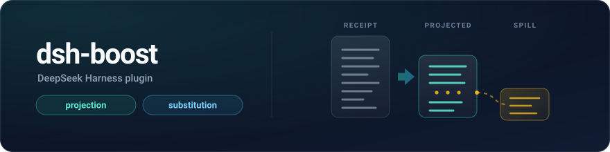
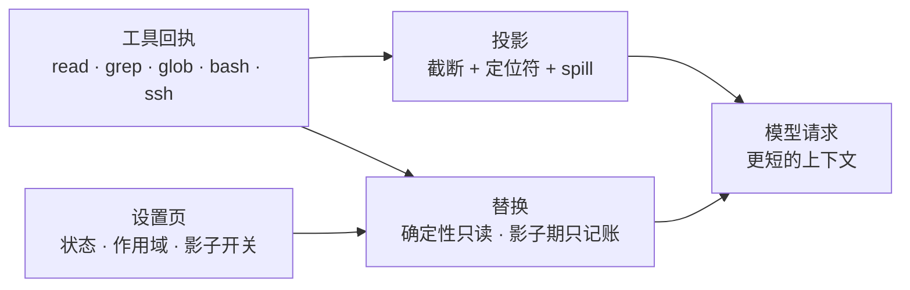

<div align="center">

[English](README.en.md) | **简体中文**

</div>

<div align="center">



</div>

# dsh-boost

**降低 DeepSeek Harness 的 token 消耗** — DSH 插件

用**工具回执投影**与**确定性只读替换**把每次模型请求回放的历史压短：大回执截断成头尾加定位符、
原文落 spill 可回读；跨工具重复的只读结果用确定性替换省掉一次模型回合。附一个同源设置页，
用来看降级码、节省账与生效配置。



> **状态：v1 已实现。** 投影、替换与控制面均已落地，测试套件全部通过。收益区间是设计阶段的
> **事前估算**（下界 3.5% / 理想上界 10.0%；投影侧在 300 个最长会话上的聚合净额约 0.4%），
> 两端都是离线估算、**不是每会话保底**，交付物无法复算——见 [`docs/RELEASE.md`](docs/RELEASE.md) §3。

## 它做什么

DSH 每次模型请求都会回放全部历史。本机 300 个最长会话的实测聚合里，97.01% 的输入是缓存读，
工具回执是体积主体（bash 61.75%、read 22.13%、ssh 10.01%），而下一步真正会用到的部分通常
远小于回执本身。

插件做两件事：

- **投影**：工具回执进入上下文之前，按工具族保留头尾，把中段换成可检索的落盘句柄；原文仍可
  取回，页脚给出路径。按固定阈值确定性执行，不产生逐次决策。
- **替换**：计划里重复的只读调用（`read` / `grep` / `glob`）若已有确定性证据满足守卫，直接
  提交，不再向模型要一次决策；多候选时用一次独立的辅助请求选一个。

v1 的**事前估算**区间是 raw `totalTokens` 的 **3.5%（下界）– 10.0%（理想上界）**；投影侧在
300 个最长会话上的**聚合**净额约 **0.4%**。两端都是离线估算：**3.5% 不是保底，也不是每会话
保底**——短会话可能倒亏，交付物里没有任何工具能复算它。口径、快照与推导见
[原理](docs/how-it-works.md)。

设置页（宿主设置面板的「Token 效率」）用来查看降级码、节省账与生效配置，并修改作用域与两个
开关；它写的是 `scope.json`，与 `boost` 工具走同一个 CAS。

## 安装

Node.js `>=24.9.0`，DSH `>=0.2.2-rc.4 <0.2.3-0`（**区间**，不是精确钉法）。替换只在 POSIX
上可用；v1 面向 web profile。

```bash
dsh plugin --profile <name> add dsh-boost@^0.3.5 --registry=https://registry.npmjs.org/
```

`dsh plugin` 要求指定 profile，其余参数转发给该 profile 里的 pnpm（所以 pnpm 必须在 PATH
上）；本地 checkout 安装先 `npm run build`，再把绝对路径传给 `add`。npmjs 上的 `latest` 是
`0.3.5`；镜像可能滞后，在意 registry 时显式带上 `--registry`。版本历史、镜像与
`0.0.0-stage` 的坑见[运维](docs/operating.md#安装与版本)。装完**必须重启 DSH**（插件在宿主
启动时加载）；web profile 就是重启 `dsh web`。

## 启用

装上之后插件默认不做事（`scope.json` 不存在时是 `selected` + 空列表 + 影子）。`boost` 是
**模型工具，不是 shell 命令**——这个包没有 `bin`，每一步都在对话里让模型调用。最短的诚实路径：

1. 调 `boost`，参数 `{"cmd":"status"}`，确认 `ok: true`、`degraded` 为空。
2. 写入要暴露的工作区，`baseRevision` 取刚读到的 `revision`（首次为 `0`）：

   ```json
   { "cmd": "scope-set", "body": { "mode": "selected", "workspaceIds": ["<workspace-id>"] }, "baseRevision": 0 }
   ```

3. 影子一周：保持 `shadow: true`、`projection: "shadow"`，照常工作。
4. 确认 `hasSpill` 为 `true` **且** `degraded` 不含 `ERR_HOST_SPILL_UNUSABLE`，把
   `projection` 设为 `"on"`。
5. 影子报告可接受后，把 `shadow` 设为 `false`；第一次真正替换后按
   [`docs/RELEASE.md`](docs/RELEASE.md) §4 盯 `content[].thinking` 的 400。

完整 walkthrough、每个字段与回滚见[运维](docs/operating.md#启用)。`workspaceIds` 是宿主的
workspace UUID，不是路径；找不到时单用户机器可以用 `"mode": "global"`。

## 设置页

装好并启用后，宿主设置面板里会多出一节「Token 效率」（英文界面 “Token efficiency”）。它做
三件事：看状态、改作用域、提示两个危险开关。投影切到 `on` 时提示 spill 前置条件，关影子时
提示盯一次 `content[].thinking` 的 400；两处都给回滚办法，都**只提示不做硬门**。读不到数据时
显示稳定码而不是空白表格；`curl <host>/dsh-boost/api/state` 返回同一份 JSON。

| 它做什么 | 内容 |
|---|---|
| 看 | 降级码与处置、替换节省的上下界、投影毛额/净额、取回次数、收据计数、常驻开销、生效配置（只读） |
| 看（蒸馏） | 开关、适用族、触发阈值、输出上限、等待上限、路由；以及 `calls`/`tokens`/`adopted`/`rejected`/`fallback` 与送去蒸馏的字符数合计 |
| 写 | `<dshHome>/boost/scope.json` 的四个字段：`mode`、`workspaceIds`、`shadow`、`projection` |

**蒸馏的配置改不了**：`distillation.*` 在 profile 的 `cordis.patch.yml` 里，不在 `scope.json`，页面只
按生效值显示。`enabled` 为真时页面会多一块提示（`role="note"`，三句：多一次调用、产物钉住、关掉
只影响之后），**只提示不做硬门**——它比替换轻（不改模型判断，只改模型看到的内容），但每次调用都
真花钱，且产物一旦采用就钉住。

蒸馏（receipt distillation，ADR 0001）的收据：**被采用时写的是 `code: 'projected'`**（`kind: 'projection'`）
加 `mode: 'adopted'` 与 `distill_*` 字段——对账本读者它就是这条回执的投影，`distill` 只是决策名，不是收据码。
未采用时写 `distill-failed`、`distill-rejected:empty`、`distill-rejected:timeout`、
`distill-rejected:unverifiable`、`distill-rejected:not-smaller`、`distill-rejected:not-worth-it`；
超时后迟到的调用另写一条 `distill-late`。其中 `empty`/`unverifiable`/`not-smaller` 三种会钉一条无正文的
墓碑，重放读它而不重新调模型；`timeout` 与 `not-worth-it` 不钉——前者要留机会给迟到的答案，后者依赖的
剩余步数会随会话增长，钉住等于把一个已被证据推翻的判断冻死。逐条含义与处置见 [发布说明](docs/RELEASE.md) 的「收据 `code`：
跳过与重置」一节。

写入与 `boost` 工具的 `scope-set` 走**同一个** CAS，所以两边改都不会互相覆盖；别人先改了，
页面会给出 `ERR_SCOPE_REVISION_CONFLICT` 并保留你的草稿。逐字段、逐码的细节见
[运维](docs/operating.md#降级码与错误码)。

## 深入

这些文档在仓库里，不在 npm tarball 里（`files` 只带 `dist`、`locale`、`static`、`cordis.patch.yml`、两份
README、`LICENSE`、`NOTICE`；`src/` 也不进包，`dist` 的 sourcemap 内联了源码）。在 npm 页面上
请从仓库读取。

| 文档 | 它回答什么 |
|---|---|
| [原理](docs/how-it-works.md) | 投影、替换与准入怎么工作；数字从哪来；协议段与缓存前缀的关系 |
| [运维](docs/operating.md) | 怎么装、启用、回滚、卸载；配置键、降级码、状态字段与已知限制 |
| [发布验收](docs/RELEASE.md) | `npm run verify:package` 怎么跑；两条发布门不变式、零 peerDependencies 与安装规格、降级码矩阵；20 任务人工回归与影子周复算 |
| [设计稿](docs/superpowers/specs/2026-11-18-dsh-token-efficiency-design.md) | 目标、证据、架构、契约、度量、风险、发布形态 |
| [宿主契约附录](docs/superpowers/plans/2026-11-18-host-contracts.md) | 逐条抄自宿主源码的接口准绳 |
| [三层委派研究](docs/research/2026-11-18-three-tier-delegation.md) | 缓存、路由阈值、压缩、校验的 25 条一手来源 |

源码与文档在仓库 [github.com/SAXEM1997/dsh-boost](https://github.com/SAXEM1997/dsh-boost)；
`package.json` 的 `repository`、`homepage`、`bugs` 都指向它。下面的文档链接是仓库相对路径。

## 许可证

Apache-2.0。机制移植自 [HarnessMM](https://github.com/YuhuaJiang2002/HarnessMM)（Apache-2.0）：
扁平候选银行、GDR 守卫、CCS 单候选提交与闭集选择器；**EDG 的图/链（`predecessor_id`）与
RSI 循环没有移植**。随包分发 `NOTICE`。
